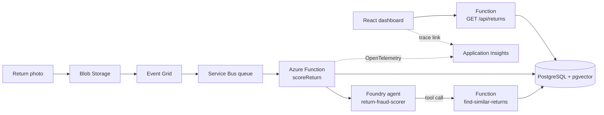

# ReturnGuard

AI-assisted fraud triage for e-commerce returns. A return photo lands in cloud storage, an event-driven pipeline wakes up an Azure Function, an Azure AI Foundry agent scores the fraud risk, and the result shows up on a React dashboard with a link to the full distributed trace.

This is a portfolio project that turns Microsoft AI-200 (Developing AI Cloud Solutions on Azure) coursework into a real, running system instead of mocks. The data is synthetic but carries **known ground-truth fraud labels**, so the agent's accuracy can actually be measured.

## What it does

1. A customer return (reason text + photo) is stored. The photo is uploaded to Azure Blob Storage as `<return_id>.<ext>`.
2. Blob Storage emits a "blob created" event through Event Grid into an Azure Service Bus queue.
3. An Azure Function consumes the message, loads the return from PostgreSQL, and asks an Azure AI Foundry agent (`return-fraud-scorer`) to assess it.
4. While reasoning, the agent can call a **similar-case tool**: a vector search (pgvector) over past returns' reason text, labeled with their fraud archetype.
5. The agent returns `{ score, reasoning }`. The Function stores it in `risk_scores` together with the OpenTelemetry trace id.
6. A React dashboard lists returns sorted by risk, filters high-risk ones, and links each detail page to its trace in Application Insights.

## Architecture



| Layer | Tech |
|-------|------|
| Ingestion | Blob Storage, Event Grid, Service Bus |
| Compute | Azure Functions v4 (Node/TypeScript) |
| AI | Azure AI Foundry agent, Azure OpenAI `text-embedding-3-large` |
| Data | Azure Database for PostgreSQL Flexible Server + `pgvector`, plain `pg` (no ORM) |
| Observability | OpenTelemetry to Application Insights |
| Frontend | React 19, TypeScript, Vite, React Router |
| Auth to Azure | `DefaultAzureCredential` (managed identity / developer login) |

## The fraud archetypes

The seed data injects six fraud patterns (about 15% of all returns), plus a legit baseline. Each return has a row in `fraud_labels`; `archetype = NULL` means confirmed legit.

| Archetype | Signal |
|-----------|--------|
| `serial_refunder` | One customer returns 70-90% of their orders |
| `item_not_received` | Same customer files three "never arrived" claims |
| `return_farm` | Cluster of look-alike accounts with tightly clustered timing |
| `wardrobing` | Apparel returned within a short wear window |
| `price_arbitrage` | `unit_price` below current price, returned long after purchase |
| `mismatched_evidence` | Same few photo URLs reused across unrelated products |

## Repository layout

```
returnGuard/
├── backend/                       Azure Functions app + data seeding scripts
├── frontend/returnguard-dashboard React + Vite dashboard
└── docs/learning/                 Personal study notes (architecture, design options, roadmap)
```

- [`backend/README.md`](backend/README.md): functions, services, data scripts, how to run.
- [`frontend/README.md`](frontend/README.md): dashboard structure and how to run.
- [`docs/learning/`](docs/learning/00-index.md): deep-dive notes written while building.

## Quick start

Prerequisites: Node 20+, Azure Functions Core Tools v4, Azurite (local storage emulator), and Azure resources (PostgreSQL with `pgvector`, Foundry project + agent, Service Bus, Blob Storage, Application Insights). There is no offline mode; the external services are real.

```bash
# 1. Backend
cd backend
npm install
# create .env and local.settings.json (see backend/README.md)
npx tsx seed.ts          # build the synthetic dataset
npm start                # build + func start on :7071

# 2. Frontend
cd ../frontend/returnguard-dashboard
npm install
# create .env with VITE_API_BASE_URL=http://localhost:7071/api
npm run dev
```

## Status

| Area | State |
|------|-------|
| Synthetic data layer (7 tables, 6 archetypes, embeddings) | Done |
| Blob, Event Grid, Service Bus, Function, Foundry agent scoring | Done |
| Similarity-search tool exposed to the agent | Done |
| OpenTelemetry tracing with trace links in the UI | Done |
| Dashboard (list, filter, search, detail) | Done |
| Redis risk cache, Key Vault, App Configuration, feature flags | Planned |
| Containerized deploy (Container Apps + ACR) | Planned |
| Automated tests, accuracy evaluation harness | Planned |

## Design notes

- **Raw SQL over an ORM.** Prisma repeatedly failed to install on the dev setup, so the data layer uses parameterized queries through `pg.Pool`.
- **Ground truth by construction.** Because fraud is injected deliberately, precision and recall of the agent can be computed against `fraud_labels`.
- **Agent as a tool-user.** Similar-case search is an HTTP endpoint the agent calls, not code the Function orchestrates, so the model decides when it needs history.
- **Trace id stored with each score.** Every score row links back to the exact trace that produced it.

## Security note

The HTTP endpoints currently use anonymous auth and permissive CORS for local development. Do not deploy as-is. See `backend/README.md` for the hardening checklist.
