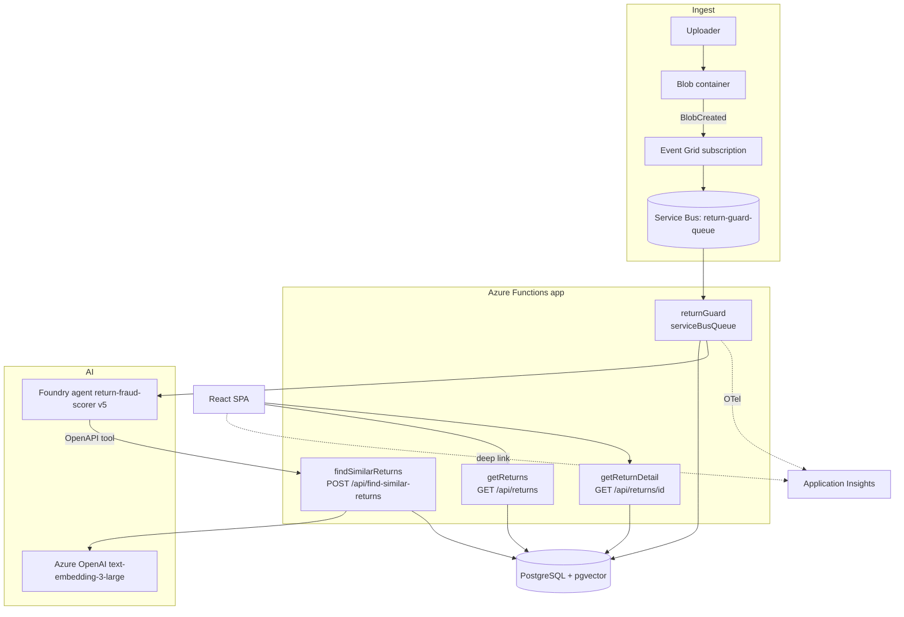
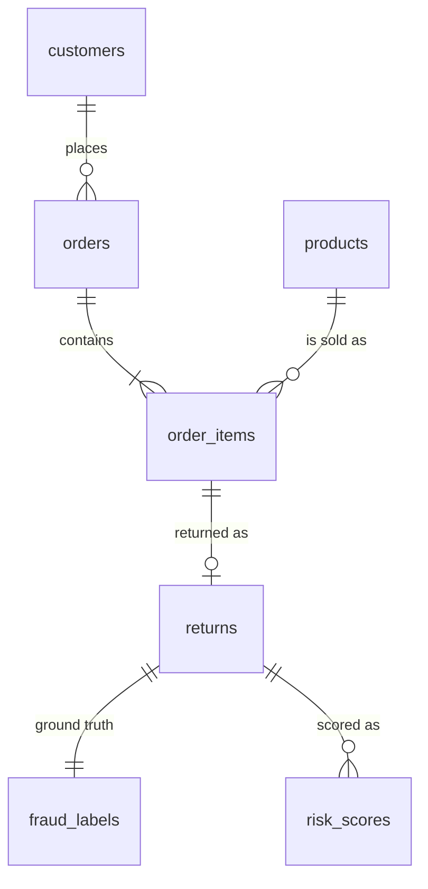

# 02. Architecture deep dive

## 1. System context



## 2. Backend layout

```
backend/
├── db.ts                       shared pg.Pool (SSL on, rejectUnauthorized false)
├── host.json                   Functions host: App Insights sampling, extension bundle 4.x
├── tsconfig.json               commonjs/es6, rootDir ".", include src only
├── src/functions/              triggers (thin)
│   ├── scoreReturn.ts          Service Bus trigger, orchestration, spans
│   ├── findSimilarReturnHttp.ts  tool endpoint
│   ├── getReturns.ts           list API
│   └── getReturnDetail.ts      detail API
├── src/services/               logic (reusable)
│   ├── foundryAgent.ts         agent call + response validation
│   ├── find_similar_return.ts  embed + vector search
│   └── tracing.ts              OTel SDK init (side-effect import)
└── *.ts (root)                 seed and maintenance scripts, run by tsx
```

Pattern: **thin trigger, fat service.** Triggers parse input and shape output; services hold logic. `scoreReturn.ts` is the exception: it contains orchestration inline.

## 3. The scoring function, line by line (`scoreReturn.ts`)

1. `import '../services/tracing'` starts the OTel SDK at module load. Import order matters: instrumentation should start before other work.
2. `DefaultAzureCredential` + `BlobServiceClient` are created once at module scope (reused across invocations; avoids re-auth per message).
3. `app.serviceBusQueue("returnGuard", { connection: "ServiceBusConnection", queueName })` registers the trigger (v4 model: code-first registration, no `function.json`).
4. Message body is the Event Grid event. Guards: `contentType` must start with `image/`; `contentLength` must be at least 1000 bytes. Both return silently (message completes, not retried).
5. `return_id` is the first dot-separated segment of the second URL path part: `/container/<id>.jpg` gives `<id>`.
6. Query `returns` by id.
7. `downloadBlob(url)` fetches the bytes, but the result (`imageBuffer`) is **not used**; the agent receives the URL. See G4.
8. Child span `foundry.agent_call` wraps `scoreReturnWithAgent(rows[0], url)`.
9. Insert into `risk_scores` with `reasoning_trace_id = rootSpan.spanContext().traceId`.
10. On any error: record exception on span, set ERROR, rethrow. Rethrow makes Service Bus retry and eventually dead-letter.

### Message lifecycle semantics

| Outcome | Result |
|---------|--------|
| Handler returns | Message completed (removed) |
| Handler throws | Abandoned, redelivered up to `maxDeliveryCount`, then dead-letter queue |
| Skipped by guard (return without throw) | Treated as success; the bad blob is silently dropped |

## 4. The agent contract (`foundryAgent.ts`)

- Client: `AIProjectClient(endpoint, DefaultAzureCredential)`, then `.getOpenAIClient()`.
- Flow: `conversations.create` with one user message containing `input_text` (metadata JSON) and `input_image` (`detail: "high"`), then `responses.create({ conversation })` with `agent_reference { name, version }`.
- Output contract: `response.output_text` must parse as JSON and satisfy `isAgentRiskAssessment` (numeric `score`, string `reasoning`). Otherwise throw, which triggers retry.
- Versioning: the agent version is a constant (`"5"`). Pinning a version makes behavior reproducible; changing the prompt means publishing a new version and bumping this.

The model's behavior (instructions, tool schema, output format) lives in the Foundry portal, **not in this repo**. That is a reproducibility gap (G7).

## 5. The retrieval tool (`find_similar_return.ts`)

```
reason text
  -> embeddings.create(model = deployment, input = [reason])        3072 floats
  -> toVectorLiteral (toFixed(8))                                   "[0.01234567,...]"
  -> SELECT ... reason_embedding <=> $1::vector AS distance
     WHERE embedding IS NOT NULL AND ($2 IS NULL OR id != $2)
     ORDER BY distance LIMIT k
  -> breakdown { legit: n, <archetype>: n }, top_matches with similarity = 1 - distance
```

- `<=>` is pgvector cosine distance; similarity is `1 - distance`.
- `excludeReturnId` prevents a return from matching itself.
- The HTTP wrapper validates JSON and `reason`, defaults `k` to 10, and maps failures to 400/500.
- No ANN index exists (see G9): 3072 dimensions exceed pgvector's index limit of 2000 for `vector`, so a `halfvec` cast or reduced dimensions would be needed to index.

## 6. Data model



Columns visible from code (the DDL itself is not in the repo):

| Table | Known columns |
|-------|---------------|
| customers | id, name, email, signup_date |
| products | id, external_id (unique), name, category, price |
| orders | id, customer_id, ordered_at, status |
| order_items | id, order_id, product_id, quantity, unit_price |
| returns | id (uuid), order_item_id, reason, photo_url, submitted_at, reason_embedding vector(3072) |
| fraud_labels | id, return_id, archetype (NULL = legit) |
| risk_scores | return_id, score (NUMERIC), reasoning, reasoning_trace_id, scored_at, similar_cases jsonb |

Design points:
- `unit_price` is snapshot data. Never derive it from `products.price`.
- `fraud_labels` is separate from `returns` so ground truth never leaks into the production path by accident. In a real system the label table would not exist at decision time. **Caution:** the list and detail APIs expose `archetype` to the UI; that is acceptable for a demo of evaluation but would be label leakage in production.
- `risk_scores` allows multiple rows per return (no unique constraint is visible), which is why reprocessing duplicates rows, and why list queries can multiply rows (G5).

## 7. HTTP API

| Route | Query/body | Response |
|-------|-----------|----------|
| `GET /api/returns` | `risk=high`, `search=<id substring>`, `limit` (50), `offset` (0) | `{ returns: [...], meta }`, sorted by `score DESC NULLS LAST` |
| `GET /api/returns/{id}` | | `{ id, reason, archetype, score, reasoning, scored_at, reasoning_trace_id, similar_cases }` |
| `POST /api/find-similar-returns` | `{ reason, return_id?, k? }` | `{ total_checked, breakdown, top_matches }` |

Dynamic SQL in `getReturns` builds `$n` placeholders from a counter: safe against injection because values are always parameters; only fixed strings are concatenated.

## 8. Seed pipeline

```
seed.ts
  ensureSchema()          CREATE EXTENSION vector; ALTER TABLE ... IF NOT EXISTS
  resetTables()           TRUNCATE ... RESTART IDENTITY CASCADE   (destructive!)
  pool.end()
  child: import_product.ts            DummyJSON paging (10 per page), UPSERT by external_id
  child: generate_customer_orders.ts  300 customers, tiers 70/25/5 percent, 1-4 items per order
  child: generate_returns.ts          archetypes, then legit sized for 15% fraud
  child: backfill_reason_embeddings.ts  batches of 50, one UPDATE per row
```

Why child processes: each script owns and closes its own pool, so no shared lifecycle bugs.

## 9. Frontend architecture

```
main.tsx -> BrowserRouter -> App
  App: Routes
    "/"            ReturnsPage  (state: returns, loading, error, highRiskOnly, searchTerm)
                     FilterBar  (local inputValue, 300 ms debounce, then onSearchChange)
                     ReturnsList (table + badge)
    "/returns/:id" ReturnDetail (state: item, loading, error)
api.ts          fetch wrappers; throw on !ok
types.ts        ReturnItem, normalizeReturn
traceUrl.ts     portal deep link from env vars
```

Data flow: filter state changes, `useEffect` refetches, `normalizeReturn` coerces `score`, components render. There is no cache, no request cancellation, and no polling (F1, F5 in file 05).

## 10. Observability

- `tracing.ts`: `NodeSDK` + `AzureMonitorTraceExporter`, service name `returnguard-function`.
- Spans: `scoreReturn.process` (root) and `foundry.agent_call` (child). Attribute `return.id`.
- `host.json` samples Application Insights telemetry except Requests.
- The trace id column plus `buildTraceUrl` closes the loop from a UI row to the exact run.

## 11. Configuration map

| Setting | Where defined | Used by |
|---------|--------------|---------|
| DATABASE_URL | `.env`, `local.settings.json` | `db.ts` |
| AZURE_OPENAI_ENDPOINT / API_KEY / EMBEDDING_DEPLOYMENT | same | embedding code |
| APPLICATIONINSIGHTS_CONNECTION_STRING | same | `tracing.ts` |
| ServiceBusConnection, AzureWebJobsStorage | `local.settings.json` | Functions host |
| Blob account URL, Foundry endpoint, agent name/version | **hardcoded in source** | `scoreReturn.ts`, `foundryAgent.ts` |
| VITE_* | frontend `.env` | `api.ts`, `traceUrl.ts` |
