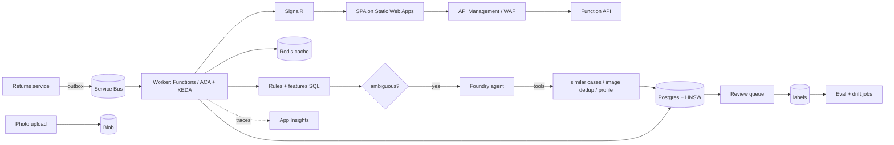

# 07. System design options

How else could this be built, how does it scale, and what would an interviewer probe.

## 1. Current design in one line

Blob upload, Event Grid, Service Bus, one Function per message, synchronous agent call, Postgres for everything, polling-free SPA reading Postgres through Functions.

## 2. Alternative designs

### A. Direct HTTP scoring (synchronous)
Client posts return, API calls the agent, returns the score.
- Pros: simple, immediate result.
- Cons: user waits on a slow model call, no retry buffer, load spikes hit the model directly.
- Use when: low volume and the score gates the user flow (for example at checkout).

### B. Queue-first, skip Event Grid (current minus one hop)
The API that accepts the return writes the DB row and sends a Service Bus message itself.
- Pros: explicit message contract (you control the schema, include `return_id`); no parsing blob paths; no Event Grid; can enrich message.
- Cons: the upload and the message are two writes (needs outbox pattern for atomicity).
- Why it matters: today the `return_id` is encoded in the blob filename, a fragile implicit contract.

### C. Transactional outbox
Write the return and an `outbox` row in one DB transaction; a relay publishes to Service Bus.
- Pros: no lost or phantom messages.
- Cons: relay component.

### D. Durable Functions orchestration
Orchestrator runs: fetch profile, call agent, persist, notify, with built-in retries and state.
- Pros: clear workflow, human-approval step (wait for external event), fan-out/fan-in for multiple models.
- Cons: more concepts; replay-safe code constraints.
- Use when: multi-step flows (scoring then manual review then refund).

### E. Container Apps worker
A long-running worker reading Service Bus with KEDA scaling.
- Pros: connection pooling, no cold start, controllable concurrency, any language.
- Cons: more to operate than Functions.

### F. Streaming/analytics path
Return events to Event Hubs, stream processing (Stream Analytics, Fabric) for real-time aggregates (returns per customer per hour).
- Use when: velocity features at high volume.

### G. Rules + ML + LLM layered scoring
1. Cheap deterministic rules (return rate, price delta) short-circuit obvious cases.
2. A classical model (gradient boosting) on tabular features.
3. The LLM agent only for ambiguous cases or for image evidence and explanations.
- Pros: cost, latency, determinism, explainability; LLM reserved for what only it can do.
- Cons: three components to maintain.
- This is the most realistic production shape, and a strong talking point: "don't use an LLM where a SQL query works."

## 3. Data layer options

| Concern | Current | Alternative | Trade-off |
|---------|---------|-------------|-----------|
| Vectors | pgvector in Postgres | Azure AI Search (hybrid keyword + vector + semantic rerank) | Search: better relevance, extra service/cost. pgvector: one datastore, transactional joins |
| Vector scale | Sequential scan | HNSW on `halfvec` | Needed beyond tens of thousands of rows |
| Features | On-the-fly SQL | Feature table or feature store, materialized views | Faster reads vs staleness |
| Cache | None (Redis planned) | Redis for profiles, CDN for static UI | Complexity vs latency |
| Analytics | Same OLTP DB | Read replica or Fabric/Synapse | Isolates heavy queries |
| Images | Blob | Blob + metadata table + hash index | Dedup, audit |
| Schema | Ad hoc ALTER | Migration tool | Repeatability |

## 4. Scaling analysis

Assume 1 million returns per day (about 12 per second average, maybe 100 per second peak).

| Component | Bottleneck | Mitigation |
|-----------|-----------|-----------|
| Agent/model calls | Tokens per minute quota, latency 2-10 s | Queue as shock absorber, limit concurrency (`maxConcurrentCalls`), model deployment quota, cache by content hash, rules-first gating |
| Functions scale-out | Each instance opens its own DB pool; Postgres connection limit | PgBouncer, small `max` per pool, cap instance count |
| Postgres writes | `risk_scores` inserts: trivial. Seeds irrelevant | Fine until very high rates |
| Vector search | Full scan | HNSW; precompute per-reason-text results; cache identical reasons (many repeat) |
| Embedding calls | Per-request cost | Cache embeddings by normalized reason text (small vocabulary) |
| List API | `ORDER BY score DESC` over join, `ILIKE` | Index on `risk_scores(score)`, covering index, keyset pagination, latest-score materialization |
| Cost | Agent tokens with high-detail images | `detail: low` first pass, escalate only if uncertain |

Backpressure: Service Bus buffers; throttle consumer concurrency to what the model quota allows; DLQ for poison; autoscale on queue length.

## 5. Reliability design

- Delivery: at-least-once, so consumers idempotent. Unique `(return_id, agent_version)`.
- Failure classes: transient (retry with backoff), permanent (dead-letter with reason), poison (alert).
- Timeouts on every external call; budgets summed below the Service Bus lock duration (or renew locks).
- Degraded mode: if the agent is down, mark "unscored", route to manual review; do not block returns.
- Disaster recovery: Postgres PITR and geo-backup; IaC to rebuild; blobs with soft delete.
- Multi-region is rarely warranted here; document the RPO/RTO instead.

## 6. Security design

- Edge: API Management or Front Door with WAF, rate limits, JWT validation.
- Identity: managed identity everywhere possible; no keys.
- Network: private endpoints for Postgres, Storage, Service Bus; VNet integration for Functions. Today everything uses public endpoints.
- Data: PII (customer name, email) minimization; mask in logs and traces; retention policy; tag data classification.
- AI-specific: prompt-injection defenses, output validation (done), content safety filters, no PII to the model unless needed, log prompts carefully.
- Agent tool endpoint: auth that proves the caller is the agent.

## 7. Observability design

- Traces: add `pg` and HTTP auto-instrumentation; propagate trace context through Service Bus (so upload to score is one trace).
- Metrics: queue depth, scoring latency p50/p95, agent error rate, score histogram, tokens used, cost per return.
- Logs: structured JSON, correlation id = `return_id`.
- Alerts: DLQ not empty, p95 latency, error rate, score distribution drift.
- KQL workbook (planned stretch): top slow runs, failures by cause.
- Sampling: keep 100% of scoring traces if the UI links to them.

## 8. Evaluation and ML-ops design

- Offline: labeled sample, metrics per archetype, threshold curves.
- Online: shadow mode (new agent version scores but does not act), A/B via feature flag.
- Human-in-the-loop: reviewer outcomes become labels; active learning picks uncertain cases.
- Versioning: agent version, prompt hash, embedding model, and dataset version stored with every score.
- Guardrails: score clamped to [0, 1], explanation required, minimum evidence fields.

## 9. Frontend design options

| Option | When |
|--------|------|
| Current SPA calling Functions | Fine for internal tools |
| TanStack Query for data | Caching, retries, cancellation: do this soon |
| Static Web Apps | Built-in auth, deploy from GitHub, API proxy |
| Next.js/SSR | Only if SEO or server-side auth rendering needed (not here) |
| Real-time via SignalR | When reviewers watch a live queue |
| Component library (Fluent UI/MUI) | When tables, filters, a11y grow |

## 10. Reference target architecture

## 11. Interview question bank (with pointers)

1. Why a queue between storage events and compute? (buffering, retries, DLQ, backpressure)
2. What happens if the Function crashes after calling the model but before the INSERT? (redelivery, duplicate cost, idempotency)
3. How do you stop the same photo being scored twice? (content hash, unique key)
4. Why pgvector instead of Azure AI Search? When would you switch?
5. How do you know the agent works? (labels, harness, thresholds, per-archetype recall)
6. How would you detect a return farm? (graph/cluster features: shared device, address, email pattern, timing)
7. Where does PII flow, and how do you minimize it?
8. How do you roll out a new prompt safely? (versioning, shadow, A/B, rollback)
9. What breaks first at 100x load? (model quota, DB connections)
10. How would you explain a score to a customer or auditor? (reasoning text, features, trace, similar cases)
11. What are the failure modes of LLM-as-classifier? (inconsistency, injection, drift, cost)
12. How do you avoid label leakage in synthetic data?

Practice: answer each in 90 seconds using the actual code as evidence.
